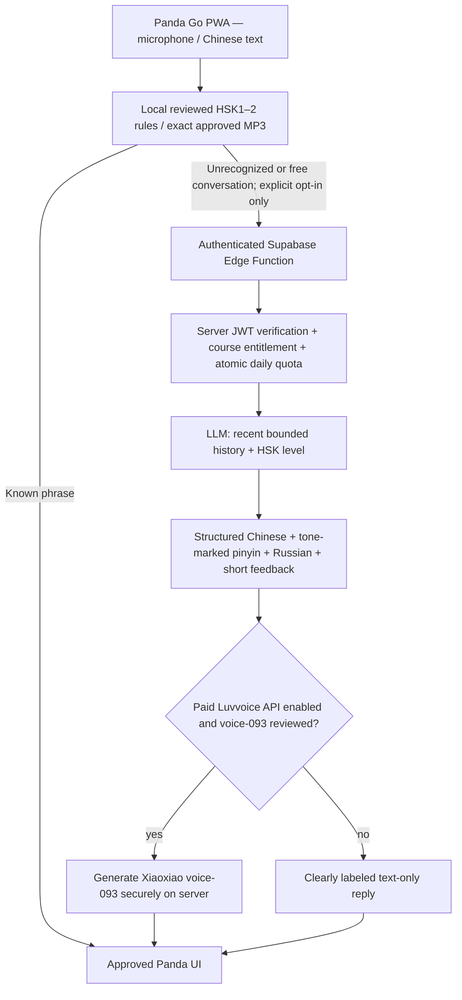

# Panda AI · Secure Conversational Engine — Architecture v1 (2026-11-22)

**Status: foundation staged in GitHub only. No live LLM or Luvvoice API traffic. The approved Panda AI v524 is unchanged.**

## Current verified inventory

- The public Panda Go PWA is hosted on GitHub Pages: `panda-voice-pilot.html`. Its current HSK2 brain uses exact, reviewed text rules and only approved matching MP3s, with Android browser speech recognition. This is **not** a free-form LLM.
- An **existing healthy Supabase project** `vswpftgbpietfqasurgo` is already connected to Panda Go. It contains a `panda-ai-pilot` Edge Function that explicitly returns **mock** responses, and `panda_course_entitlements`, `panda_ai_daily_usage` tables with RLS.
- The existing server quota policy is **10 replies/day during the first 30 days after purchased_at, 3/day thereafter**. A SQL function named `panda_reserve_response(p_user_id uuid,p_utc_day date,p_limit integer)` reserves daily usage. These limits are *existing pilot business logic*, not a price or service promise.
- A voice registry already plays user-approved MP3s for exact Mandarin phrases. **Conversational Panda AI = Xiaoxiao (Luvvoice voice-093, female). Panda Street uses a different male voice.**
- The current learner microphone uses Android Chrome speech recognition; a browser transcript alone does not verify Mandarin tones.

## Recommended design

### Modules prepared in this branch

1. `assets/panda-ai-secure-bridge-v1.mjs`: explicit-only authenticated browser transport; last **8** session turns, up to **500** characters each; only HSK1/HSK2; validates Mandarin response, translation and exact Xiaoxiao audio provenance. No chat storage in browser storage, no secret key, **not imported by current Panda**.
2. `supabase/functions/panda-ai-chat-v1/index.ts`: **undeployed prototype** using already existing Supabase Auth, entitlements, and `panda_reserve_response` quota reservation. OpenAI Responses API Structured Outputs returns real model text only if enabled. `realAI=true` is emitted only on a successful provider response; unavailable configuration produces `AI_DISABLED`. It never substitutes fake replies.
3. `supabase/functions/panda-ai-chat-v1/policy.ts`: existing quota rules.
4. `supabase/config.toml`: `verify_jwt=false` because the function explicitly verifies the signed-in student against Supabase Auth in code. Never interpret this flag as permission to skip authentication.
5. Tests and CI audit: valid roles, bounded memory, server-only secrets, correct CORS, no made-up acoustic tone verification, and voice-093-only dynamic audio URL.

### Voice integration findings

The official Luvvoice API reference at https://luvvoice.com/doc documents **voice-093 (Xiaoxiao Chinese Female)** and POST `https://luvvoice.com/api/v1/text-to-speech` using server-only Bearer token with `voice_id`, `rate`, `pitch`, `volume`. The documentation states **API requires Plus or above**, and returns a temporary CDN URL. The new prototype always requests `voice-093` and never chooses a male/Street/native-speaker substitute. Until credentials and a current voice-to-voice comparison are approved, `PANDA_XIAOXIAO_TTS_ENABLED` stays off and new AI answers remain text-only. Existing user-uploaded MP3s are unchanged.

**Important:** a correct Hanyu Pinyin transcription is not the same as an acoustic pronunciation or tone measurement. Generated pinyin and Russian explanation must be labeled *AI-generated/unreviewed* until checked against a lexicon or teacher. No claims of tonal accuracy without independent audio evidence.

## Before any live activation

1. Decide provider, exact supported model, **daily cost ceiling**, account handling and privacy notice. API usage is paid separately from ChatGPT subscriptions. Confirm who is permitted to use the system; never deploy a public unauthenticated proxy.
2. Set secrets **in Supabase Dashboard / Edge Function Secrets**, never in the GitHub repo, browser, screenshots, chat messages, or Github Actions logs:
   - `OPENAI_API_KEY` — model provider key
   - `PANDA_LLM_MODEL` — chosen model identifier
   - `PANDA_AI_LIVE_ENABLED=true` — deliberate opt-in (off by default)
   - `PANDA_SUPABASE_SECRET_KEY` — server-only Supabase secret key, if not already using existing legacy service role for the pilot
   - `LUVVOICE_API_TOKEN` — paid Luvvoice API token **only if** automatic audio is enabled
   - `PANDA_XIAOXIAO_RATE` — **explicit rate verified against the currently approved Panda AI MP3s**, do not assume trainer speed or overwrite settings
   - `PANDA_XIAOXIAO_TTS_ENABLED=true` — deliberate separate paid-audio opt-in (off by default)
3. Deploy only the **new isolated** `panda-ai-chat-v1` Edge Function; leave existing `panda-ai-pilot` unmodified and mock-labeled. Confirm access control with an authenticated test learner; verify invalid JWT→401, no course→403, daily limit→429, missing provider config→503.
4. Test 20–50 HSK1–2 conversation cases (including day-off → film → comedy → why), incorrect sentences, ambiguity and ASR failures. Test model's Russian translations and tone-marked pinyin against trusted reference; never auto-grade acoustic tones.
5. If Luvvoice API enabled, compare returned voice-093 audio with the five approved Xiaoxiao MP3s for **timbre, speed, endings, tone and residual noise**. API-generated audio uses expiring URLs: do not store these as permanent MP3 paths in offline cache.
6. Enable a **separate AI opt-in mode** in an isolated staging page first. Only after Android Chrome, cost, privacy and regression QA is complete should the main Panda AI integrate this fallback. The current Panda remains unchanged until that explicit release gate.

## Known limitations and risks

- The prototype is not deployed and has **not made a single live model or paid TTS call**. It is **not** a production AI feature.
- An API account with credits / paid TTS subscription may be needed. The Supabase mock pilot is **not** an OpenAI provider.
- Current quota reservation happens **before** calling the provider; a provider failure can consume a quota unit, matching the current pilot's approach. Add an auditable refund/idempotency flow before commercial release.
- Client sends only the **last eight turns** to the server, and provider replies are not permanently stored here. A privacy policy should explicitly mention processing conversation snippets by the model provider and audio text by Luvvoice when enabled.
- Model-generated pinyin can contain mistakes. HSK words and human-reviewed recordings remain the trusted default.
- Daily quota is a cost limit only for authenticated enrolled users; also add per-account burst limits, centralized provider budget alerts, moderation and abuse controls before paid/public deployment.
- Supabase docs evolve; check https://supabase.com/docs/guides/functions/auth and https://supabase.com/docs/guides/functions/secrets before deployment, including the 2026 transition from JWT-based legacy keys.

## References

- Supabase Edge Functions auth: https://supabase.com/docs/guides/functions/auth
- Supabase Edge Function secrets: https://supabase.com/docs/guides/functions/secrets
- OpenAI Structured Outputs: https://developers.openai.com/api/docs/guides/structured-outputs?api-mode=responses
- Luvvoice API: https://luvvoice.com/doc

**This branch is intentionally non-breaking:** it does not change the live HTML, existing scripts, SW cache, registered voice files, approved UI or Panda Street.
