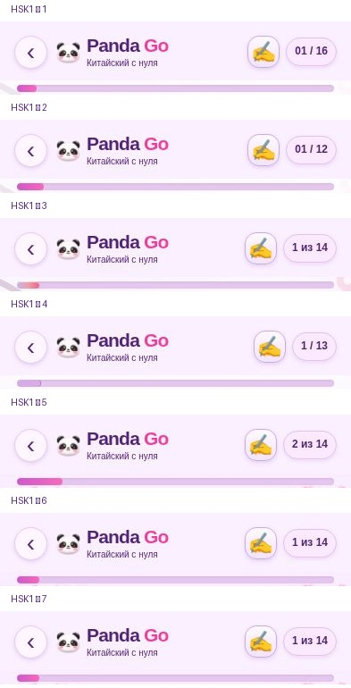

# HSK1 — шапки, кнопки и завершённые упражнения урока 4

Статус: изменения реализованы в рабочей ветке, публикация удержана до проверки реального Android/микрофона. Исходный коммит: `404e142c20aab37a6c8a24d60b60aa57028f8043`.
Резервная копия: ветка `backup/hsk1-before-header-buttons-20261117`.
Рабочая ветка: `work/hsk1-headers-lesson4-buttons-20261117`.

## Что изменено

- Одна HTML-структура шапки для всех семи уроков: исходный значок головы Панды из урока 5, Panda фиолетовым, Go розовым, подпись «Китайский с нуля», возврат, письмо, существующий счётчик. Сохранены ID счётчиков и логика прогресса. Единый шрифт Arial 21 px, высота 66 px без системного safe-area.
- Стиль прогресс-бара одинаковый. Процент по-прежнему устанавливают существующие скрипты уроков.
- Урок 4: пропуск завершённых состояний аудирования, календаря, сборки предложений и итогового теста при восстановлении/навигации. Сначала остаётся обратная связь по ответу, после «Следующий вопрос» открывается следующее задание или этап. На финальном экране компактно раскрывается повторение упражнений.
- Сохранены все 7 заданий аудирования, 4 календарных ситуации, пропись 日, диалог, 3 предложения и 10 итоговых вопросов.
- Повторение итогового теста не переписывает первый результат. Устаревший/двойной переход без подтверждённого ответа игнорируется.
- Кнопки действий уроков 1–4: золотые основные, светло-сиреневые вторичные, светло-голубые аудио; тени, видимое нажатие, focus и disabled. Учебные карточки и плитки слов не перекрашены как обычные кнопки.
- В уроке 4 уменьшены отступы заголовков и карточек. Нижняя навигация остаётся отдельным фиксированным блоком существующей flex-композиции.

## Количество экранов и старый прогресс

**13 → 13 содержательных этапов.** На присланных скриншотах показаны завершённые состояния реальных заданий, а не три дополнительные страницы в массиве экранов. Удалить этапы 8, 11 и 12 означало бы удалить календарь, сборку предложений и экзамен. Поэтому упражнения сохранены; пустые состояния больше не являются остановками при навигации.

Дополнительно обработано аналогичное состояние аудирования на 5/13 из фактически приложенного скриншота. Счётчик и полоса продолжают отражать реальные 13 этапов; при возврате пройденные упражнения пропускаются. Переиндексации экранов и миграции ключей не требуется. `pg-hsk1-v215-weekdays`, индексы упражнений, старый результат v214 и первая попытка сохранены. Восстановление с завершённых 5/13, 8/13, 11/13 и 12/13 проверено тестом.

## Защищённые элементы

Карта `hsk1-map.html`, HSK2, Panda AI, изображения, MP3, тексты и учебные данные не изменены. Общая таблица стилей уроков 5–7 и их скрипты не изменены. В HTML уроков 5–7 за пределами шапки допущены только подключение изолированной таблицы шапок, маркер страницы и класс существующего progress-бара. Это проверено сравнением с исходным коммитом.

В живом Chrome исходные и новые кнопки уроков 5–7 на вводном/учебном экранах сравнены по размеру, цвету, фону, рамке, скруглению, тени и шрифту — полное совпадение. Координаты контента могут сдвинуться из-за единой высоты шапки; верстка и стили самих кнопок не менялись. Низ экрана остаётся на прежнем месте.

## Проверки

| Проверка | Результат |
|---|---|
| `verify-hsk1-final-unification-v421.cjs` | PASS: семь шапок, защита 5–7 и карты, динамические кнопки, disabled/action attributes |
| `verify-hsk1-fourth-v216.cjs` | PASS: полный путь урока, аудиогейтинг, ошибки, календарь, письмо, диалог, сборки, экзамен, review, старый прогресс; добавлены проверки пропуска завершённых состояний и неизменности первой оценки |
| `verify-hsk1-first-upgrade-v295.cjs` | PASS |
| `verify-hsk1-second-v203.cjs` | PASS |
| `verify-hsk1-third-v213.cjs` | PASS |
| `verify-hsk1-fifth-v227.cjs` | PASS |
| Синтаксис изменённых JS и `git diff --check` | PASS |
| Chrome, 360×800 / 393×852 / 412×915 | На вводных/восстановленных экранах семи уроков нет горизонтальной прокрутки и выхода нижних кнопок за viewport; одинаковая шапка. 21 проверка |
| Реальный MP3 в Chrome | После воспроизведения 星期一 урока 4 отмечено «Прослушано 1 из 3»; это реальный media ended, не мок |
| Физический Android Chrome, системная навигация, микрофон устройства | НЕ ПРОВЕРЕНО; публикация удержана |

Browser-проверка выполнена в настоящих узких viewport iframe локального приложения в desktop Chromium. Это проверяет адаптивную верстку, но не является запуском на физическом Android. Живые скриншоты — ниже; тестовая оболочка не включена в продукт и не публикуется.

Два существующих общих проверочных скрипта не проходят уже на исходном коммите (подтверждено отдельным исходным worktree):
- `verify-hsk1-first-v189.cjs` — ожидает старый query `v=371`, тогда как исходная страница уже использует `v=420`.
- `verify-weather-one-voice-v239.cjs` — `Missing unified weather voice for 天气`; проверяет старый голосовой набор. Причина несоответствия текущим голосовым файлам в этой задаче не исправлялась: изменение MP3 и уроков 5–7 запрещено.

Эти проверки не объявляются успешными. Browser-проверки не подтверждают качество произношения, тонов, шумов или реальную запись микрофона.

## Реальные скриншоты

[Урок 1](../../qa/hsk1-v421/lesson-1-393.jpg) · [Урок 2](../../qa/hsk1-v421/lesson-2-393.jpg) · [Урок 3](../../qa/hsk1-v421/lesson-3-393.jpg) · [Урок 4](../../qa/hsk1-v421/lesson-4-393.jpg) · [Урок 5](../../qa/hsk1-v421/lesson-5-393.jpg) · [Урок 6](../../qa/hsk1-v421/lesson-6-393.jpg) · [Урок 7](../../qa/hsk1-v421/lesson-7-393.jpg)

[Воспроизведение MP3](../../qa/hsk1-v421/lesson4-audio-confirmed.jpg). Данные: `qa/hsk1-v421/responsive-matrix.json`, `qa/hsk1-v421/protected-buttons.json`.

## Изменённые файлы

- Семь HTML уроков: `hsk1-first-v189.html`, `hsk1-second-v203.html`, `hsk1-third-v212.html`, `hsk1-fourth-v214.html`, `hsk1-fifth-v227.html`, `hsk1-family-v231.html`, `hsk1-weather-v231.html`.
- Новые локальные компоненты: `assets/hsk1-headers-v421.css`, `assets/hsk1-controls-v421.css`, `assets/hsk1-controls-v421.js`.
- Навигация завершённых упражнений: `assets/hsk1-fourth-v220.js`.
- Проверки: `scripts/verify-hsk1-fourth-v216.cjs`, `scripts/verify-hsk1-final-unification-v421.cjs`.
- Этот отчёт и фактические материалы `qa/hsk1-v421/`.

## Прямые ссылки на действующие уроки

Это текущая опубликованная версия; изменения ветки станут видны по этим адресам только после публикации.

| Урок | Адрес |
|---|---|
| 1 | https://trommelschlager-ai.github.io/chinese-coach-pwa/hsk1-first-v189.html |
| 2 | https://trommelschlager-ai.github.io/chinese-coach-pwa/hsk1-second-v203.html |
| 3 | https://trommelschlager-ai.github.io/chinese-coach-pwa/hsk1-third-v212.html |
| 4 | https://trommelschlager-ai.github.io/chinese-coach-pwa/hsk1-fourth-v214.html |
| 5 | https://trommelschlager-ai.github.io/chinese-coach-pwa/hsk1-fifth-v227.html |
| 6 | https://trommelschlager-ai.github.io/chinese-coach-pwa/hsk1-family-v231.html |
| 7 | https://trommelschlager-ai.github.io/chinese-coach-pwa/hsk1-weather-v231.html |

Следующий обязательный шаг: на Android пройти проверку внешнего вида/системных отступов, микрофона и переходов; затем повторить релевантные проверки и публиковать.
